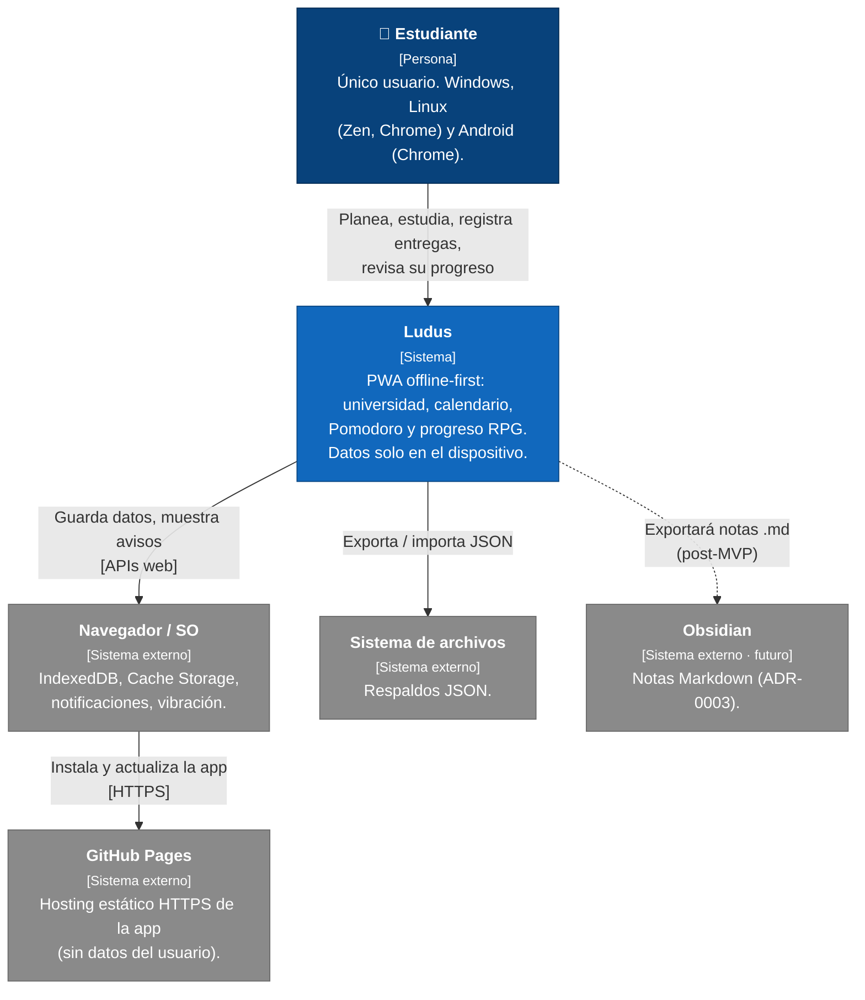
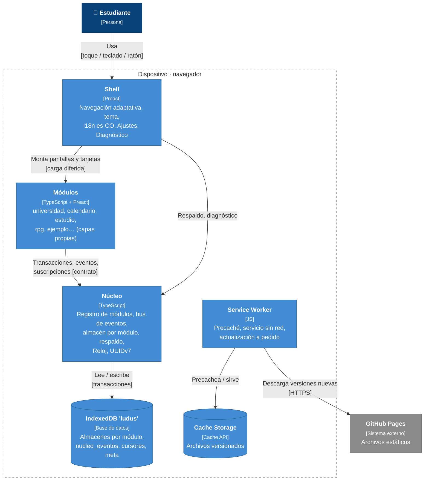
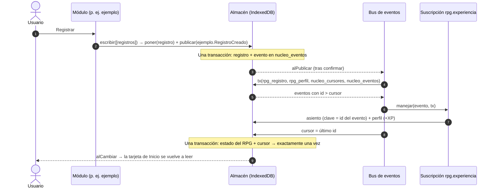

# Arquitectura — Ludus

Estilo: **monolito modular en el cliente** (PWA), con capas hexagonales dentro de cada módulo y comunicación entre módulos **solo por eventos de dominio**. No hay backend (ADR-0002, ADR-0004).

## 1. C4 — Nivel 1: contexto



## 2. C4 — Nivel 2: contenedores



## 3. Estructura de carpetas

```
web/src/
├── main.tsx                 # raíz de composición (único lugar que conoce implementaciones concretas)
├── nucleo/
│   ├── contrato.ts          # contrato de módulo (tipos que implementa cada módulo)
│   ├── dominio/             # EventoDeDominio, Reloj, UUIDv7 (puro, sin DOM)
│   ├── aplicacion/          # bus de eventos, registro de módulos, respaldo, puertos
│   ├── infraestructura/     # IndexedDB, diagnóstico, plataforma, Service Worker, reloj del sistema
│   └── i18n/                # traductor, formatos Intl, textos es-CO del núcleo
├── ui/                      # shell: App, enrutador, apariencia, componentes base, vistas del núcleo, estilos (tokens)
├── modulos/
│   ├── index.ts             # descubrimiento automático (import.meta.glob)
│   └── <id>/
│       ├── modulo.ts        # DefinicionDeModulo (contrato)
│       ├── textos.es-CO.json
│       ├── dominio/         # entidades, VOs, reglas puras
│       ├── aplicacion/      # casos de uso (una función = un caso de uso)
│       ├── infraestructura/ # migraciones, adaptadores
│       └── ui/              # pantallas y tarjetas
├── sw/sw.js                 # plantilla del Service Worker
└── arquitectura.test.ts     # reglas de dependencias verificadas en CI
```

Reglas (verificadas por `arquitectura.test.ts`): un módulo no importa a otro; `dominio/` no importa UI, infraestructura, aplicación ni Preact; `nucleo/` y `ui/` no importan módulos concretos.

## 4. Contrato de módulo

Archivo `web/src/nucleo/contrato.ts`. Cada módulo exporta por defecto `definirModulo({...})`:

| Campo | Qué aporta | Regla validada al arrancar |
|---|---|---|
| `id` | Prefijo de todo lo del módulo | minúsculas/dígitos; único; no reservado (`nucleo`, `inicio`, `ajustes`, `diagnostico`, `mas`) |
| `version` | SemVer del módulo | formato `x.y.z` |
| `nombre`, `textos` | Textos es-CO externalizados | claves con prefijo `<id>.`; el nombre existe |
| `rutas[]` | `{ patron, titulo, vista: () => import(...) }` | empiezan por `/<id>`; únicas; título existe |
| `navegacion?` | Entrada en la barra/riel: `{ etiqueta, icono, orden, ruta }` | apunta a una ruta propia |
| `tarjetasDeInicio?` | Resúmenes para Inicio (carga diferida) | — |
| `migraciones[]` | Esquema propio, versiones 1, 2, 3… | consecutivas; nunca se editan |
| `eventos` | Catálogo de eventos que publica, con versión y descripción | tipo `<id>.NombreEnPasado` |
| `suscripciones?(ctx)` | Manejadores de eventos (propios o ajenos) | id único; tipos bien formados |
| `alIniciar?(ctx)` | Tarea mientras la app está abierta, en cualquier pantalla (recordatorios, temporizadores); devuelve cómo detenerla | errores aislados (Diagnóstico) |
| `proveedores?(ctx)` | Datos que otros módulos pueden **consultar** (ADR-0013): `fuentesDeCalendario[]` (`ElementoDeAgenda` por rango), `referencias` (`ReferenciaDeEntidad` por tipo, texto o ids) y `fichas` (plantillas para el calendario, ADR-0015) | creados una vez y perezosamente; si fallan, se ignoran y se anotan en Diagnóstico |

Cada pantalla recibe `{ ctx, params }`, con `ctx: ContextoDeModulo` = `{ moduloId, almacen, reloj, nuevoId, t, formatos, diagnostico, notificaciones, integraciones, navegar }`. `ctx.integraciones` expone `fuentesDeCalendario()`, `tiposDeReferencia()`, `buscarReferencias(consulta)` → `{referencias, fallos}`, `fichas()` → `{grupos, fallos}` y `alCambiarFichas()`: así se leen datos de otro módulo sin importarlo ni tocar su almacén. `navegar(ruta, { reemplazar: true })` no agrega una entrada al historial ni mueve el foco (para recorrer periodos sin llenar el botón atrás). `ctx.almacen` solo ve los almacenes del módulo. `tx.publicar(tipo, datos, { ocurridoEn })` permite fechar un hecho que pasó antes de publicarlo (nunca en el futuro; ADR-0016).

### Cómo agregar un módulo (sin tocar los existentes)
1. Crear `web/src/modulos/<id>/modulo.ts` con su `definirModulo`.
2. Declarar migraciones, eventos, textos, rutas y navegación.
3. Si debe dar XP: agregar reglas en `modulos/rpg/reglas.v1.json` (configuración del RPG, no código).
3b. Si otros deben ver sus fechas o vincular sus entidades: declarar `proveedores` (el Calendario y los buscadores lo descubren solos).
4. `npm run check`. El registro y la prueba de arquitectura avisan si algo rompe el contrato.

### Piezas compartidas para módulos
- `nucleo/dominio/zona-horaria.ts`: hora civil ↔ UTC con `Intl` (sin depender de la zona del dispositivo); la usan `formatos` y el dominio del Calendario.
- `nucleo/dominio/color.ts` (`ColorDeAgenda`: token o `#rrggbb` con variantes legibles) y `ui/color.ts` (`atributosDeColor`); `nucleo/dominio/fichas.ts` (`FichaDeCalendario`, `Vinculo`).
- `nucleo/dominio/agenda.ts`: `ElementoDeAgenda` (lenguaje publicado para el Calendario) y la paleta `COLORES_CATEGORICOS` (tokens `--color-cat-*`, marcas con `data-color` y `.marca-color`).
- `ctx.formatos`: además de fecha/hora/número, `entradaLocal` / `desdeEntradaLocal` (valor de `<input type="datetime-local">` siempre en hora de Bogotá, sin depender de la zona del dispositivo) y `relativo` ("mañana", "dentro de 3 horas").
- `ui/deshacer.tsx`: `ofrecerDeshacer({ mensaje, deshacer?, confirmar?, ocultar? })` muestra la barra "Deshacer" del shell durante 10 s (también Ctrl+Z). Las acciones diferidas (`confirmar`) se ejecutan al vencer el plazo o al pasar la app a segundo plano.
- `ui/componentes.tsx` + utilidades de `base.css` (`fila`, `filtros`, `campo__error`, `grupo--en-linea`, `etiqueta--alerta`).

## 5. Almacenamiento

- Una base IndexedDB `ludus`. Almacenes `<modulo>_<nombre>`; el módulo usa nombres cortos.
- `nucleo_meta` guarda la versión de esquema aplicada por módulo. Al abrir, las migraciones pendientes se aplican en una sola actualización de versión (ADR-0009).
- Toda escritura es una **transacción** (`almacen.escribir([...], async tx => ...)`): cambios y eventos se confirman juntos o no se confirma nada.
- La API de migraciones es declarativa (`crearAlmacen`, `crearIndice`, `transformar`…) para poder portarla a SQLite si un día se usa Tauri.

## 6. Bus de eventos en proceso y suscripción del RPG



- **Entrega exactamente una vez:** el estado del suscriptor y su cursor se guardan en la misma transacción. Si la app se cierra entre (3) y (5), al abrir se retoma.
- **Orden:** por UUIDv7 (monótono; ver ADR-0009).
- **Fallos aislados:** si un manejador lanza un error, su transacción se deshace, la suscripción queda "En pausa" en Diagnóstico (con botón "Reanudar") y las demás siguen.
- **Cadenas:** un manejador puede publicar eventos (p. ej. `rpg.NivelAlcanzado`); el bus los procesa en la siguiente vuelta.
- **Historial:** una suscripción nueva procesa todos los eventos previos (útil para recalcular), salvo `historial: 'desdeAhora'`.
- **El RPG se suscribe a `*`** y decide la XP con `reglas.v1.json`. Ningún módulo conoce al RPG.

## 7. Capacidades de plataforma (puertos)

| Capacidad | Puerto / adaptador | Comportamiento si falta |
|---|---|---|
| Tiempo | `Reloj` / `relojDelSistema` | — |
| Ids | `FuenteAleatoria` / `crypto.getRandomValues` | — |
| Datos | `MotorDeAlmacen` / `AlmacenIndexedDb` | Pantalla de error de arranque, sin tocar datos |
| Persistencia | `pedirAlmacenamientoPersistente` | Aviso en Ajustes: "exporta respaldos" |
| Archivos | `descargarArchivo`, `leerArchivoComoTexto` | Funciona en todos los navegadores |
| Sin conexión | Service Worker | Sin SW (p. ej. HTTP por IP), la app funciona mientras esté abierta |
| Notificaciones | `Notificador` (`ctx.notificaciones`) / `notificadorDelNavegador` vía Service Worker (Android no permite `new Notification()`) | Solo bandeja dentro de la app; con la app cerrada no hay aviso (ADR-0004) |
| Vibración | `detectarCapacidades` (iteración Estudio) | Solo aviso en pantalla |

## 8. Decisiones relacionadas
ADR-0002 (sincronización), 0004 (PWA), 0008 (stack), 0009 (almacenamiento y eventos), 0010 (composición y rutas), 0011 (alcance del Calendario), 0012 (recurrencia e .ics propios).
