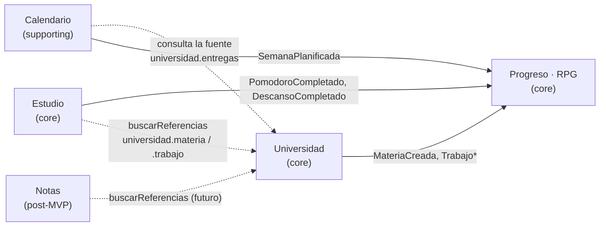
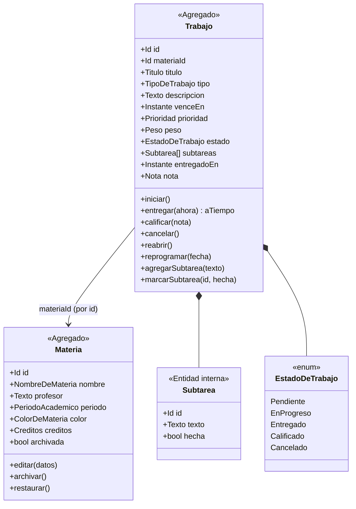
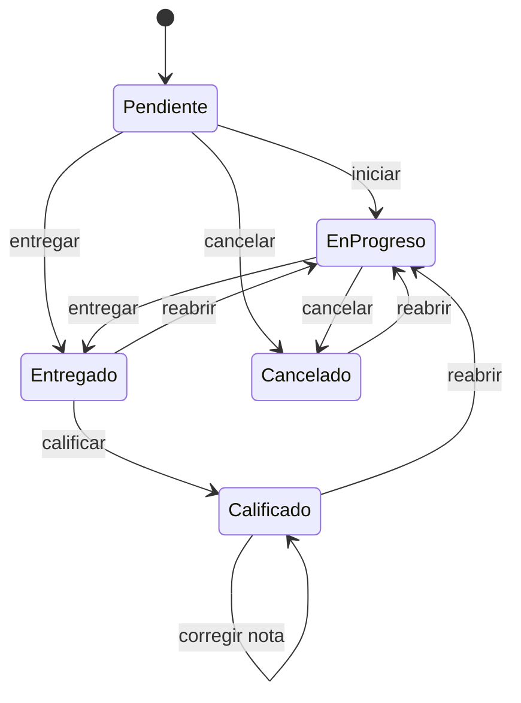
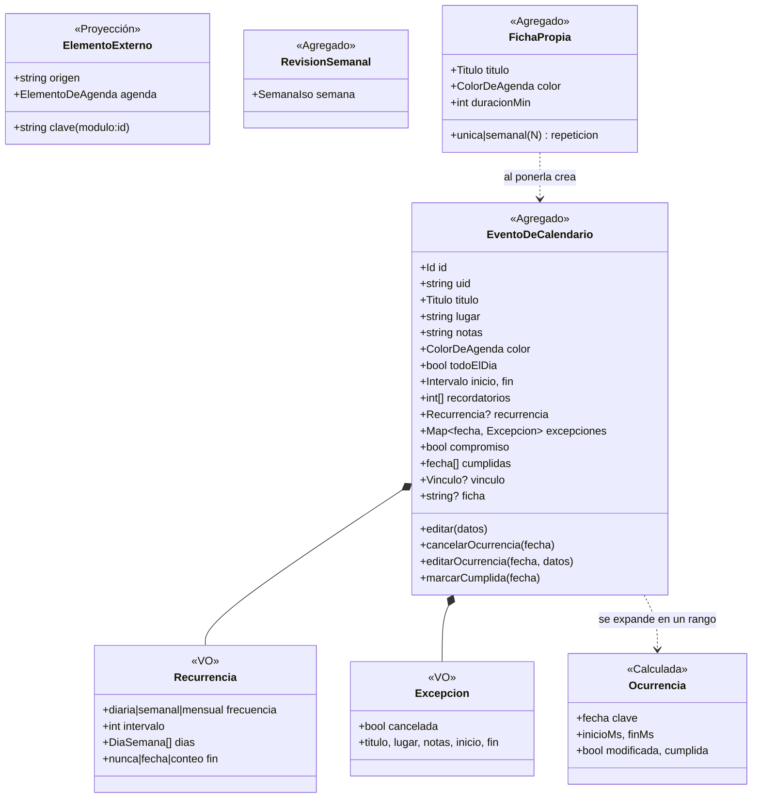
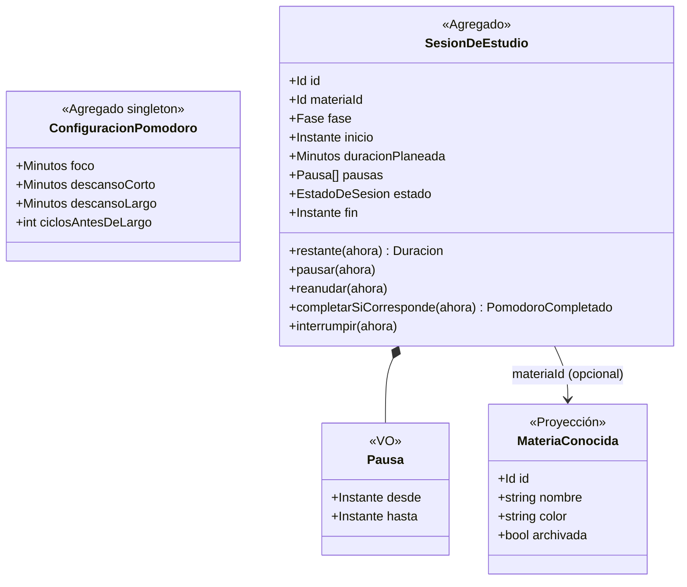
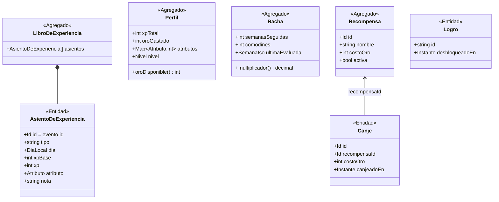

# Modelo de dominio — Ludus

Un **bounded context por módulo**. Cada contexto tiene su lenguaje, sus agregados y sus eventos. Se comunican por **eventos de dominio** para reaccionar (ADR-0009) y por **consultas a proveedores registrados** para leer datos de otro módulo (ADR-0013); nunca leen el almacén de otro. Los nombres del código coinciden con los de este documento (lenguaje ubicuo en español).

## 1. Mapa de contextos



| Relación | Patrón (DDD) | Detalle |
|---|---|---|
| Todos → Núcleo | Shared Kernel | Tipos mínimos y estables: `EventoDeDominio`, `ElementoDeAgenda`, `Reloj`, ids. |
| Universidad → Calendario | Open Host Service + Published Language (ADR-0013) | Universidad registra la fuente `universidad.entregas` (`ElementoDeAgenda`); el Calendario consulta **todas** las fuentes registradas por rango sin saber de quién son. Además sigue proyectando eventos con `datos.agenda` de módulos que no registren fuente (OCP). |
| Universidad, Estudio, Calendario → RPG | Publisher / Subscriber (conformista del lado RPG) | El RPG se suscribe a `*` y decide el valor con `reglas.v1.json`. Los publicadores no saben que existe. |
| Universidad → Estudio, Notas | Open Host Service (ADR-0013) | Universidad registra referencias de tipo `universidad.materia` y `universidad.trabajo`. Los consumidores guardan `{tipo, id}` y resuelven con `ctx.integraciones.buscarReferencias` (sin copias ni imports). |

### Lenguaje publicado: `ElementoDeAgenda`
Cualquier evento puede incluir en sus datos:
```ts
agenda: {
  id: string;            // id estable del elemento en su módulo de origen
  titulo: string;
  inicio: string;        // ISO UTC
  fin?: string;          // ISO UTC; ausente = puntual (vencimiento)
  todoElDia?: boolean;
  tipo: 'vencimiento' | 'evento' | 'bloque';
  estado: 'pendiente' | 'hecho' | 'eliminado';
  color?: string;        // token de color, no hex
}
```

## 2. Contexto Universidad

**Lenguaje:** *Materia* (asignatura de un *periodo académico*), *Trabajo* (lo que se entrega o presenta: tarea, taller, quiz, parcial, proyecto, exposición), *Subtarea*, *Peso* (% de la nota de la materia), *Nota* (0,0–5,0), *Entrega* (fecha real en que se entregó), *Indicador de urgencia* (vencido, hoy, próximos 7 días, más adelante). Versión 2 (iteración 3, ADR-0013 y ADR-0014); el antiguo *Entregable* se migró a *Trabajo*.





| Tipo | Elementos |
|---|---|
| Agregados | `Materia`, `Trabajo` (referencia a Materia **por id**; las subtareas viven **dentro** del agregado) |
| Value objects | `NombreDeMateria` (1–60), profesor (0–80), `PeriodoAcademico` (1–20, p. ej. `2026-2`; sugerido: ene–jun = 1, jul–dic = 2), `ColorDeMateria` (paleta de tokens), `Creditos` (0–10, opcional), `Titulo` (1–120), descripción (0–2000), `TipoDeTrabajo`, `Prioridad` (baja, media, alta), **`Peso`** entero en décimas de % (1–1000 ↔ 0,1–100 %, opcional), **`Nota`** entero en décimas (0–50 ↔ 0,0–5,0; aprobatoria ≥ 30), `Instante` (UTC ISO 8601). Sin flotantes. |
| Invariantes | Nombre de materia único entre las **activas del mismo periodo** (sin distinguir mayúsculas ni espacios). Una materia archivada no recibe trabajos nuevos. Transiciones **solo** las del diagrama: calificado o cancelado no vuelven a pendiente; **reabrir** es deliberado, lleva a `EnProgreso` y borra `entregadoEn` y `nota`. `entregadoEn` existe si y solo si el estado es Entregado o Calificado; `nota` solo en Calificado. Tipo y peso no cambian en Entregado/Calificado. Solo se reprograma un trabajo activo (pendiente o en progreso). Máximo 50 subtareas de 1–200 caracteres; no se agregan a un trabajo cancelado. |
| Reglas derivadas | `aTiempo = entregadoEn ≤ venceEn` (Reloj inyectado). Indicador por **día local** (America/Bogota): vencido si `venceEn < ahora`; hoy; *próximos 7 días* (ventana móvil de los 6 días siguientes; con semana calendario quedaría vacío cada domingo); más adelante. Los no activos no tienen indicador. |
| Visibilidad | Los trabajos de una materia archivada se conservan (historial, calendario, XP) pero no salen en "Próximas entregas" ni en los filtros. |
| Eventos (v1) | `universidad.MateriaCreada {materiaId, nombre, color, periodo}` · `MateriaEditada {materiaId, campos[]}` · `MateriaArchivada {materiaId}` · `MateriaRestaurada {materiaId}` · `TrabajoCreado {trabajoId, materiaId, tipo, peso, venceEn, antelacionHoras}` · `TrabajoEditado {trabajoId, campos[]}` · `TrabajoReprogramado {trabajoId, venceEnAnterior, venceEn}` · `TrabajoIniciado {trabajoId}` · `TrabajoEntregado {trabajoId, materiaId, tipo, peso, aTiempo, minutosDesdeCreacion}` · `TrabajoCalificado {trabajoId, materiaId, nota, aprobado, correccion}` · `TrabajoCancelado {trabajoId}` · `TrabajoReabierto {trabajoId, desde}` · `TrabajoEliminado {trabajoId}`. Las **subtareas no publican eventos**. Una operación sin cambios (misma nota, misma fecha) no publica nada. Los eventos `Entregable*` y `MateriaRenombrada` de la v1 quedan en el historial con sus reglas. Catálogo: `modulos/universidad/aplicacion/comun.ts`. |
| Proveedores (ADR-0013) | Fuente de calendario `universidad.entregas`: trabajos no cancelados del rango (índice `por_vencimiento`), con color de la materia, `hecho` si Entregado/Calificado y `ruta` a la ficha. Referencias `universidad.materia` (detalle: periodo; inactiva si archivada) y `universidad.trabajo` (detalle: materia; inactiva si no está activo). |
| Almacenamiento | Almacenes `materias` y `entregables` (nombre conservado). Migración v2 convierte los datos de la v1 al leer y al migrar: `trabajo` → taller, `otro` → tarea; `enCurso` → enProgreso; `completado` → entregado; `completadoEn` → `entregadoEn`; sin talla; profesor vacío y periodo según la fecha de creación. |
| Implementación | `web/src/modulos/universidad/` (dominio en `dominio/{materia,trabajo,nota,consultas,errores}.ts`). `antelacionHoras` = horas completas entre registro y vencimiento; `minutosDesdeCreacion` = minutos entre `creadoEn` y `entregadoEn`. |

## 3. Contexto Calendario

**Lenguaje:** *Evento* (algo que el usuario agenda), *Serie* (evento recurrente), *Ocurrencia* (una aparición de la serie, identificada por su **fecha original**), *Excepción* (ocurrencia cancelada o modificada), *Elemento externo* (lo que aportan otros módulos: fuentes registradas, ADR-0013, o eventos con `datos.agenda`), *Recordatorio*, *Aviso* (un recordatorio vencido de una ocurrencia), *Bloque de compromiso*, *Revisión semanal*, *Ficha* (plantilla para poner algo rápido: la aportan los módulos o el usuario), *Vínculo* (entidad de otro módulo a la que apunta un evento). Implementado en las iteraciones 2 y 4 (`web/src/modulos/calendario/`, ADR-0011, 0012 y 0015).



| Tipo | Elementos |
|---|---|
| Agregados | `EventoDeCalendario` (con sus excepciones y cumplimientos), `RevisionSemanal` (id = semana ISO, p. ej. `2026-W47`), `FichaPropia` |
| Value objects | `Intervalo` (con hora: instantes UTC, fin > inicio; todo el día: fechas `AAAA-MM-DD` sin zona, fin inclusivo ≥ inicio; ≤ 14 días), `Recurrencia` (intervalo 1–99, conteo 1–999, ≥ 1 día si es semanal), `Recordatorios` (0–5, de 0 min a 4 semanas antes), `SemanaIso`, `ColorDeAgenda` (token o `#rrggbb`, ADR-0015), `Vinculo {tipo, id}`, duración de ficha (15 min–8 h), semanas de ficha (1–52) |
| Calculados (nunca se guardan) | `Ocurrencia`: la serie se expande solo para el rango visible, en hora civil de Bogotá. `Aviso`: momento = inicio − minutos. |
| Proyecciones | `agenda`: suscripción `calendario.agenda` a `*` con historial completo; upsert por `<modulo>:<agenda.id>`, borra con `estado: "eliminado"`; los datos inválidos se omiten y se anotan en Diagnóstico. |
| Invariantes | Intervalo válido. Semanal: la primera ocurrencia es el primer día elegido desde el inicio. Una excepción solo existe para una fecha que es ocurrencia; al editar la serie se descartan las que dejan de serlo. Bloque de compromiso: con hora, 15 min–8 h; se marca cumplido una vez por ocurrencia, desde que empieza hasta 48 h después de terminar. Una revisión por semana. Los elementos externos son de solo lectura. Poner una ficha = crear un evento (semanal → serie de N semanas en ese día y hora, empezando en la media hora tocada); quitarla = eliminar el evento que creó (`ficha` coincide). Borrar una ficha no borra lo ya puesto. |
| Eventos (v1) | `calendario.EventoCreado {eventoId, recurrente, compromiso}` · `EventoEditado {eventoId}` · `EventoEliminado {eventoId}` · `OcurrenciaModificada {eventoId, ocurrencia, accion: editada|cancelada|restaurada}` · `EventoMarcadoCumplido {eventoId, ocurrencia, ocurrenciaId, minutos}` · `CalendarioImportado {creados, actualizados}` · `SemanaPlanificada {semana}` · `FichaCreada/FichaEditada/FichaEliminada {fichaId}` (sin XP). `EventoCreado` lleva además `desdeFicha` desde la 0.5.0. Los eventos propios **no** llevan `datos.agenda` (el Calendario no se proyecta a sí mismo). |
| Fuentes | Cada fuente (propios, externos, fuentes registradas) se lee por separado: si una falla o tiene registros dañados, se muestra el resto con un aviso. Igual con las fichas de cada módulo. |
| Almacenamiento | Migración v2: almacén `fichas`. Los eventos guardados antes no cambian (`vinculo` y `ficha` ausentes = null). |

## 4. Contexto Estudio

**Lenguaje:** *Sesión* (un bloque de foco o descanso), *Fase* (foco, descanso corto, descanso largo), *Ciclo*, *Pausa*.



| Tipo | Elementos |
|---|---|
| Agregados | `ConfiguracionPomodoro` (único), `SesionDeEstudio` |
| Value objects | `Minutos` (foco 5–90, descanso corto 1–30, largo 5–60), `Fase`, `Pausa`, `EstadoDeSesion` (EnCurso, Pausada, Completada, Interrumpida) |
| Invariantes | **Una sola sesión activa** a la vez. `restante = duracionPlaneada − (ahora − inicio − pausado)`, calculado con el `Reloj` (nunca por "ticks"; ADR-0004). Solo se completa si `restante ≤ 0`, y el fin registrado es `inicio + duración + pausas` (no la hora en que se volvió a la app). Una pausa de más de 15 min interrumpe la sesión. |
| Proyecciones | `MateriaConocida` (desde eventos de Universidad); estadísticas por día local y materia. |
| Eventos | `estudio.PomodoroCompletado {sesionId, materiaId?, minutosFoco}` · `PomodoroInterrumpido {sesionId, minutosFoco}` · `DescansoCompletado {sesionId, minutos}` |

## 5. Contexto Progreso (RPG)

**Lenguaje:** *Experiencia (XP)*, *Asiento* (cada movimiento del libro de experiencia), *Nivel*, *Atributo*, *Oro*, *Racha semanal*, *Comodín*, *Logro*, *Recompensa*, *Canje*.



| Tipo | Elementos |
|---|---|
| Agregados | `Perfil`, `LibroDeExperiencia` (en la práctica, un almacén de asientos con clave = id del evento), `Racha`, `Recompensa`, `Logro` |
| Value objects | `Nivel` (derivado de la XP con la fórmula), `Atributo` (intelecto, disciplina, organización, bienestar), `DiaLocal` (`AAAA-MM-DD` en Bogotá), `SemanaIso` |
| Servicios de dominio | `CalculadoraDeExperiencia` (aplica reglas: base o talla, puntualidad, tramos, límites, "una vez por", multiplicador de racha), `EvaluadorDeRacha` |
| Invariantes | La XP **nunca disminuye**. `xpTotal = Σ asientos.xp`. Un evento produce como máximo un asiento (idempotencia). Oro disponible = ⌊xpTotal / 10⌋ − oroGastado ≥ 0: no se canjea sin oro suficiente. Comodines 0–2. Un logro se desbloquea una sola vez. |
| Eventos | `rpg.NivelAlcanzado {nivel, nivelAnterior}` · `SemanaDeRachaCumplida {semana, rachaSemanas}` · `RachaPerdida {semana}` · `ComodinUsado {semana}` · `LogroDesbloqueado {logroId}` · `RecompensaCreada {recompensaId}` · `RecompensaCanjeada {canjeId, recompensaId, costoOro}` · `CanjeDeshecho {canjeId}` |

Implementado en la fundación: `AsientoDeExperiencia`, `Perfil`, fórmula de nivel y `rpg.NivelAlcanzado`; reglas `xp`, `xpPorTalla` y `limiteDiarioXp`. Iteración 1: `unaVezPor` (índice `por_clave_unica`, migración v2 del RPG), `minMinutosDesdeCreacion`, `minAntelacionHoras` y `multiplicadorPuntual`, en la función pura `calcularXp`.

## 6. Contexto Notas (post-MVP, esbozo)

`Nota` (agregado): `id`, `titulo`, `cuerpoMarkdown`, `etiquetas[]` (VO `Etiqueta`: minúsculas, sin espacios), `vinculos[]` (ids de materia/entregable), `creadoEn`, `actualizadoEn`. Frontmatter compatible con Obsidian al exportar (`tags`, `aliases`, `created`, `updated`, `ludus_id`; ADR-0003). Eventos: `notas.NotaCreada`, `NotaEditada`, `NotaEliminada`.

## 7. Núcleo (Shared Kernel)

| Concepto | Descripción |
|---|---|
| `EventoDeDominio` | `{ id: UUIDv7, tipo: 'modulo.NombreEnPasado', modulo, version, ocurridoEn: ISO UTC, datos }` |
| `ElementoDeAgenda` | `nucleo/dominio/agenda.ts`: lenguaje publicado para el Calendario, con colores por token (`COLORES_CATEGORICOS`). |
| `Reloj` | Puerto de tiempo; `RelojFijo` en pruebas. |
| `GeneradorUuidV7` | Ids ordenables, monótonos, generables sin conexión. |
| `Transaccion` | Unidad de trabajo: cambios + eventos, todo o nada. |
