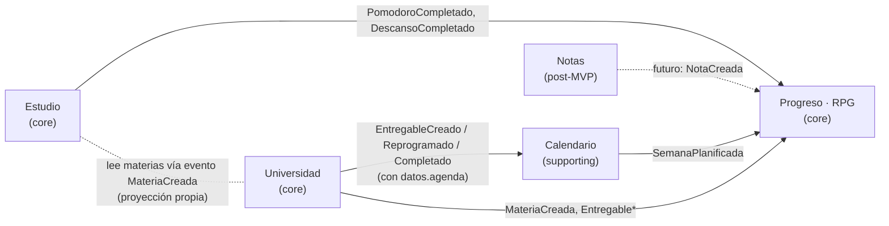
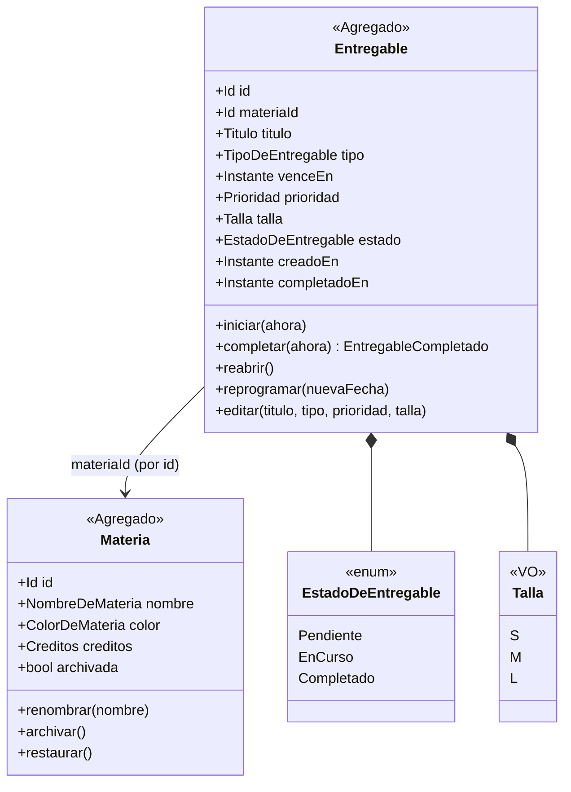
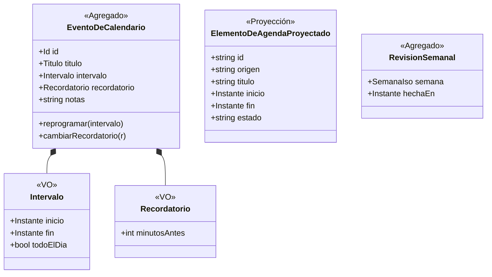
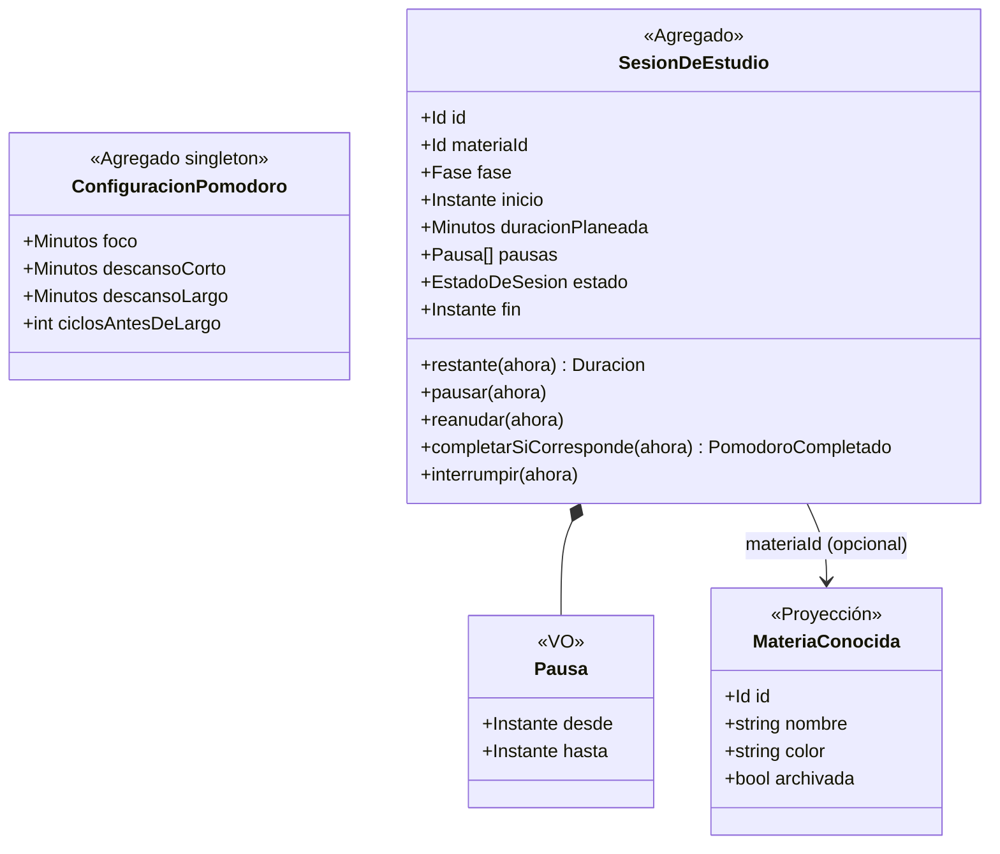
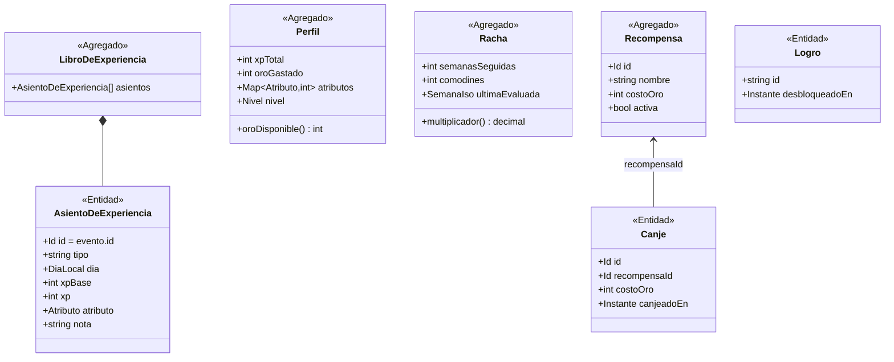

# Modelo de dominio — Ludus

Un **bounded context por módulo**. Cada contexto tiene su lenguaje, sus agregados y sus eventos; se comunican solo por eventos de dominio (ADR-0009). Los nombres del código coinciden con los de este documento (lenguaje ubicuo en español).

## 1. Mapa de contextos



| Relación | Patrón (DDD) | Detalle |
|---|---|---|
| Todos → Núcleo | Shared Kernel | Tipos mínimos y estables: `EventoDeDominio`, `ElementoDeAgenda`, `Reloj`, ids. |
| Universidad → Calendario | Published Language | Calendario **no** conoce Universidad: proyecta cualquier evento que traiga `datos.agenda`. Un módulo futuro aparece en el calendario sin tocar Calendario (OCP). |
| Universidad, Estudio, Calendario → RPG | Publisher / Subscriber (conformista del lado RPG) | El RPG se suscribe a `*` y decide el valor con `reglas.v1.json`. Los publicadores no saben que existe. |
| Universidad → Estudio | Proyección local | Estudio mantiene su propia copia mínima de materias (id, nombre, color) alimentada por `MateriaCreada/Renombrada/Archivada`. Nada de consultas cruzadas. |

### Lenguaje publicado: `ElementoDeAgenda`
Cualquier evento puede incluir en sus datos:
```ts
agenda: {
  id: string;            // id estable del elemento en su módulo de origen
  titulo: string;
  inicio: string;        // ISO UTC
  fin?: string;          // ISO UTC; ausente = puntual (vencimiento)
  todoElDia?: boolean;
  tipo: 'vencimiento' | 'evento' | 'bloque';
  estado: 'pendiente' | 'hecho' | 'eliminado';
  color?: string;        // token de color, no hex
}
```

## 2. Contexto Universidad

**Lenguaje:** *Materia* (asignatura del semestre), *Entregable* (trabajo, tarea, parcial u otro con fecha de entrega), *Talla* (esfuerzo declarado S/M/L), *Vencimiento*.



| Tipo | Elementos |
|---|---|
| Agregados | `Materia`, `Entregable` (referencia a Materia **por id**) |
| Value objects | `NombreDeMateria` (1–60, sin espacios extremos), `ColorDeMateria` (de una paleta de tokens), `Creditos` (0–10), `Titulo` (1–120), `TipoDeEntregable` (trabajo, tarea, parcial, otro), `Prioridad` (baja, media, alta), `Talla` (S, M, L), `Instante` (UTC ISO 8601) |
| Invariantes | Nombre de materia único entre las **activas** (sin distinguir mayúsculas ni espacios repetidos; lo verifica el caso de uso, también al renombrar y al restaurar). Una materia archivada no recibe entregables nuevos. La talla no cambia una vez `EnCurso` o `Completado`. `completadoEn` existe si y solo si el estado es `Completado`. No se completa dos veces sin reabrir. **Reabrir** vuelve a `EnCurso` (la talla sigue bloqueada). Un entregable completado no se reprograma (primero se reabre). |
| Transiciones | `Pendiente → EnCurso → Completado`; `Pendiente → Completado`; `Completado → (reabrir) → EnCurso`. Eliminar: desde cualquier estado, borrado físico (la historia queda en el registro de eventos). |
| Visibilidad | Los entregables de una materia archivada se conservan (historial y estadísticas) pero no aparecen en las listas activas ni en "Próximos vencimientos". |
| Reglas derivadas | `aTiempo = completadoEn ≤ venceEn`. `minutosDesdeCreacion` y `antelacionHoras` se calculan con el `Reloj` y viajan en el evento. |
| Eventos (v1) | `universidad.MateriaCreada {materiaId, nombre, color}` · `MateriaRenombrada {materiaId, nombre}` · `MateriaArchivada {materiaId}` · `MateriaRestaurada {materiaId}` · `EntregableCreado {entregableId, materiaId, talla, venceEn, antelacionHoras, agenda}` · `EntregableEditado {entregableId, campos[], talla, agenda}` · `EntregableReprogramado {entregableId, venceEnAnterior, venceEn, agenda}` · `EntregableIniciado {entregableId}` · `EntregableCompletado {entregableId, materiaId, talla, aTiempo, minutosDesdeCreacion, agenda}` · `EntregableReabierto {entregableId, agenda}` · `EntregableEliminado {entregableId, agenda (estado "eliminado")}`. Catálogo en código: `modulos/universidad/aplicacion/comun.ts`. Una operación sin cambios reales (mismo nombre, misma fecha) no publica nada. |
| Implementación | Iteración 1 (`web/src/modulos/universidad/`). `antelacionHoras` = horas completas entre el registro y `venceEn` (negativa si ya venció). `minutosDesdeCreacion` = minutos completos entre `creadoEn` y `completadoEn`. |

## 3. Contexto Calendario

**Lenguaje:** *Evento de calendario* (algo con hora que el usuario agenda), *Elemento de agenda* (lo que otros módulos publican), *Recordatorio*, *Revisión semanal*.



| Tipo | Elementos |
|---|---|
| Agregados | `EventoDeCalendario`, `RevisionSemanal` (id = semana ISO, p. ej. `2026-W47`) |
| Value objects | `Intervalo` (fin > inicio; ≤ 14 días; `todoElDia` usa fechas locales), `Recordatorio` (0–10 080 min antes), `SemanaIso` |
| Proyecciones | `ElementoDeAgendaProyectado`: se construye desde cualquier evento con `datos.agenda` (suscripción `calendario.agenda`, historial completo). |
| Invariantes | Intervalo válido. Una revisión por semana. Los elementos proyectados son de solo lectura (se editan en su módulo de origen). |
| Eventos | `calendario.EventoCreado {eventoId, inicio, fin, agenda}` · `EventoReprogramado` · `EventoEliminado` · `SemanaPlanificada {semana}` |

## 4. Contexto Estudio

**Lenguaje:** *Sesión* (un bloque de foco o descanso), *Fase* (foco, descanso corto, descanso largo), *Ciclo*, *Pausa*.



| Tipo | Elementos |
|---|---|
| Agregados | `ConfiguracionPomodoro` (único), `SesionDeEstudio` |
| Value objects | `Minutos` (foco 5–90, descanso corto 1–30, largo 5–60), `Fase`, `Pausa`, `EstadoDeSesion` (EnCurso, Pausada, Completada, Interrumpida) |
| Invariantes | **Una sola sesión activa** a la vez. `restante = duracionPlaneada − (ahora − inicio − pausado)`, calculado con el `Reloj` (nunca por "ticks"; ADR-0004). Solo se completa si `restante ≤ 0`, y el fin registrado es `inicio + duración + pausas` (no la hora en que se volvió a la app). Una pausa de más de 15 min interrumpe la sesión. |
| Proyecciones | `MateriaConocida` (desde eventos de Universidad); estadísticas por día local y materia. |
| Eventos | `estudio.PomodoroCompletado {sesionId, materiaId?, minutosFoco}` · `PomodoroInterrumpido {sesionId, minutosFoco}` · `DescansoCompletado {sesionId, minutos}` |

## 5. Contexto Progreso (RPG)

**Lenguaje:** *Experiencia (XP)*, *Asiento* (cada movimiento del libro de experiencia), *Nivel*, *Atributo*, *Oro*, *Racha semanal*, *Comodín*, *Logro*, *Recompensa*, *Canje*.



| Tipo | Elementos |
|---|---|
| Agregados | `Perfil`, `LibroDeExperiencia` (en la práctica, un almacén de asientos con clave = id del evento), `Racha`, `Recompensa`, `Logro` |
| Value objects | `Nivel` (derivado de la XP con la fórmula), `Atributo` (intelecto, disciplina, organización, bienestar), `DiaLocal` (`AAAA-MM-DD` en Bogotá), `SemanaIso` |
| Servicios de dominio | `CalculadoraDeExperiencia` (aplica reglas: base o talla, puntualidad, tramos, límites, "una vez por", multiplicador de racha), `EvaluadorDeRacha` |
| Invariantes | La XP **nunca disminuye**. `xpTotal = Σ asientos.xp`. Un evento produce como máximo un asiento (idempotencia). Oro disponible = ⌊xpTotal / 10⌋ − oroGastado ≥ 0: no se canjea sin oro suficiente. Comodines 0–2. Un logro se desbloquea una sola vez. |
| Eventos | `rpg.NivelAlcanzado {nivel, nivelAnterior}` · `SemanaDeRachaCumplida {semana, rachaSemanas}` · `RachaPerdida {semana}` · `ComodinUsado {semana}` · `LogroDesbloqueado {logroId}` · `RecompensaCreada {recompensaId}` · `RecompensaCanjeada {canjeId, recompensaId, costoOro}` · `CanjeDeshecho {canjeId}` |

Implementado en la fundación: `AsientoDeExperiencia`, `Perfil`, fórmula de nivel y `rpg.NivelAlcanzado`; reglas `xp`, `xpPorTalla` y `limiteDiarioXp`. Iteración 1: `unaVezPor` (índice `por_clave_unica`, migración v2 del RPG), `minMinutosDesdeCreacion`, `minAntelacionHoras` y `multiplicadorPuntual`, en la función pura `calcularXp`.

## 6. Contexto Notas (post-MVP, esbozo)

`Nota` (agregado): `id`, `titulo`, `cuerpoMarkdown`, `etiquetas[]` (VO `Etiqueta`: minúsculas, sin espacios), `vinculos[]` (ids de materia/entregable), `creadoEn`, `actualizadoEn`. Frontmatter compatible con Obsidian al exportar (`tags`, `aliases`, `created`, `updated`, `ludus_id`; ADR-0003). Eventos: `notas.NotaCreada`, `NotaEditada`, `NotaEliminada`.

## 7. Núcleo (Shared Kernel)

| Concepto | Descripción |
|---|---|
| `EventoDeDominio` | `{ id: UUIDv7, tipo: 'modulo.NombreEnPasado', modulo, version, ocurridoEn: ISO UTC, datos }` |
| `ElementoDeAgenda` | `nucleo/dominio/agenda.ts`: lenguaje publicado para el Calendario, con colores por token (`COLORES_CATEGORICOS`). |
| `Reloj` | Puerto de tiempo; `RelojFijo` en pruebas. |
| `GeneradorUuidV7` | Ids ordenables, monótonos, generables sin conexión. |
| `Transaccion` | Unidad de trabajo: cambios + eventos, todo o nada. |
